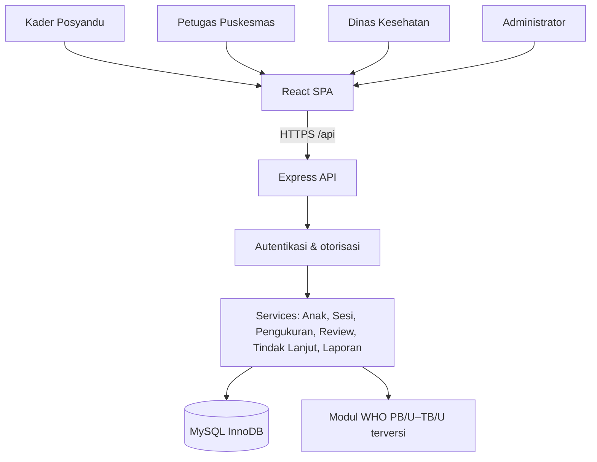
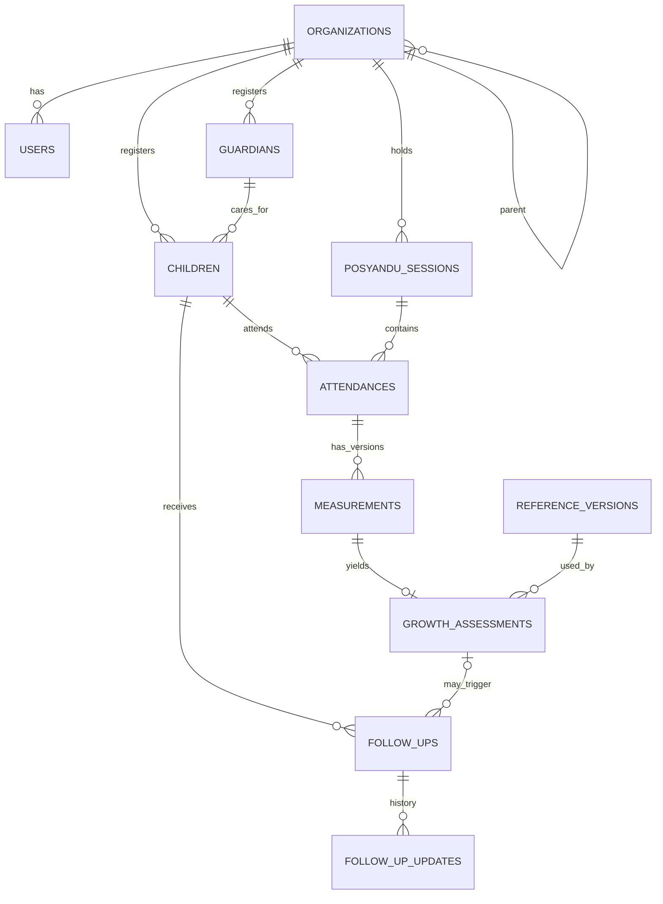

# Software Design Document — TumbuhPantau

**Versi:** 0.1 (draft teknis untuk memulai pengembangan)  
**Tanggal:** 30 Oktober 2026  
**Status:** *Draft / belum disetujui tim dan dosen*  
**Basis kebutuhan:** `PROPOSAL PPL TUMBUH PANTAU.pdf`, 48 halaman, terutama Bab 1–5.  
**Stack implementasi sesuai handoff:** React + Vite, Node.js + Express, MySQL; menggantikan Laravel/Blade/PHP pada Bab 3.3 dan 4.2 proposal. Perubahan ini **belum disinkronkan dengan proposal resmi**.

## 1. Tujuan dan ruang lingkup
TumbuhPantau adalah prototipe web responsif untuk membantu Posyandu dan Puskesmas mencatat anak, wali, sesi, kehadiran, pengukuran, histori, peninjauan hasil, tindak lanjut, dashboard agregat, dan audit. Tujuan utamanya *keterlacakan alur*, **bukan diagnosis klinis** atau klaim penurunan prevalensi stunting. Dasar: proposal halaman 3–6 dan 8–10.

### 1.1 Fitur wajib dari proposal
- **FR-01** Autentikasi; **FR-02** Organisasi/akun; **FR-03** Anak/wali; **FR-04** Sesi/kehadiran.
- **FR-05** Draf dan pengiriman pengukuran; **FR-06** Perhitungan serta penandaan PB/U–TB/U; **FR-07** Histori/grafik; **FR-08** Monitoring kelengkapan.
- **FR-09** Peninjauan hasil; **FR-10** Tindak lanjut; **FR-11** Dashboard berbasis peran; **FR-12** Ekspor agregat CSV; **FR-13** Audit; **FR-14** Koreksi pengukuran non-destruktif.
- PBI-01 s.d. PBI-12 menjadi unit pengembangan, dan AUTH-01 menjadi prasyarat. ID ini mengikuti proposal halaman 17–19.

### 1.2 Batasan MVP dari proposal
- Anak berusia **0–59 bulan pada tanggal ukur**; satu Posyandu per anak selama pilot.
- Indikator otomatis **hanya PB/U–TB/U**; grafik berat badan **aktual** tanpa klasifikasi otomatis tambahan.
- Tanpa aplikasi native, akun orang tua, offline sync, chatbot/prediksi AI medis, WhatsApp, atau integrasi ASIK/SATUSEHAT/BPJS.
- Tidak menggunakan data anak nyata dalam demo, prompt AI, atau repository; **hanya data sintetis**.
- Tidak mengumpulkan NIK, foto, koordinat rumah, dan data sosial ekonomi dalam MVP.
- CSV hanya agregat; tidak boleh mengekspor nama, tanggal lahir lengkap, atau kontak wali.

## 2. Keputusan arsitektur dan stack

| Aspek | Keputusan sementara | Alasan / konsekuensi |
|---|---|---|
| Runtime | Node.js **24 LTS** | Baseline stabil untuk tim; jalur LTS dapat dicek kembali saat setup |
| Frontend | React + Vite + Bootstrap, JavaScript | SPA; mudah membagi pekerjaan frontend |
| Backend | Express 5, JavaScript, modular monolith | REST API internal, modul terpisah tanpa microservices |
| Database | MySQL (InnoDB) | Mempertahankan rancangan relasional proposal |
| Data access | `mysql2/promise` **untuk starter** | Ringan untuk membuktikan koneksi; ORM/migration tool final masih keputusan terbuka |
| Grafik | Chart.js (rencana) | Sesuai proposal; data dibatasi dan dihitung di server |
| Auth | Cookie sesi server-side + CSRF protection (rencana) | Tidak menyimpan token di localStorage; session store produksi harus persisten |
| Testing | Node test/Vitest, Supertest, Playwright, k6 (rencana) | Test unit, integrasi, UI, beban. Alat final diputuskan sebelum Sprint 1 selesai |
| Deployment | Nginx static React + reverse proxy `/api` ke Node + MySQL privat | HTTPS dan satu origin saat demo |

> **Pemisahan keputusan:** `mysql2` dipakai hanya pada *starter*. Untuk kebutuhan transaksi kompleks dan migration, pilih **satu** pendekatan terkelola (migration SQL versioned atau ORM) sebelum membangun PBI-01. Jangan campur generator schema dengan migration manual tanpa rencana.

### 2.1 Diagram konteks


### 2.2 Alur permintaan
1. Browser membuka React SPA. Router frontend mengatur halaman, **bukan** memberikan izin data.
2. React mengirim HTTPS request ke `/api/*`, cookie sesi mengikuti kebijakan same-origin.
3. Express memeriksa sesi, peran, *organization scope*, validasi input dan aturan domain.
4. Controller memanggil service; service menjalankan transaksi melalui data access layer.
5. API mengembalikan JSON dengan bentuk yang konsisten. React merender keadaan loading, sukses, kosong, atau gagal.
6. Operasi sensitif menulis audit tanpa password, cookie, token, atau identitas yang tidak perlu.

### 2.3 Struktur direktori yang dituju
```
tumbuhpantau/
  frontend/
    src/
      app/                # app/router/providers
      pages/              # laman berdasarkan role
      components/         # komponen presentasi yang dapat digunakan ulang
      features/           # modul UI: children, sessions, measurements, reviews
      services/           # HTTP client dan kontrak frontend
  backend/
    src/
      app.js             # komposisi Express
      server.js          # listener
      config/            # konfigurasi env/DB
      middleware/        # auth, scope, error handler, CSRF
      modules/           # modul domain (routes, controller, service, repository)
      services/anthropometry/ # referensi WHO terversi dan algoritma (setelah validasi)
      db/                # migration, transaction helper, data access
    tests/
  docs/
```
**Catatan:** starter awal hanya merealisasikan bagian kecil struktur ini; folder lain dibuat saat benar-benar dibutuhkan.

## 3. Aktor dan kebijakan akses

| Kemampuan | Kader | Petugas Puskesmas | Dinas | Admin |
|---|---|---|---|---|
| Anak/wali | CRUD terbatas Posyandu sendiri | Sesuai cakupan Puskesmas | Tidak | Tidak otomatis |
| Sesi, kehadiran, ukur | Kelola wilayah sendiri | Sesuai kewenangan dan cakupan | Tidak | Tidak |
| Histori pribadi anak | Lokal | Wilayah Puskesmas | Tidak | Tidak |
| Review antropometri | Hanya lihat status relevan | Tetapkan keputusan | Tidak | Tidak |
| Tindak lanjut | Laporkan kegiatan ditugaskan | Buat/evaluasi/tutup | Tidak | Tidak |
| Dashboard & laporan | Agregat lokal | Agregat wilayah | Agregat wilayah yang diizinkan | Bukan hak klinis otomatis |
| Kelola organisasi/akun | Tidak | Tidak | Tidak | Ya |
| Audit | Sesuai fungsi & cakupan terbatas | Audit klinis wilayah sesuai kebijakan | Tidak otomatis | Audit administratif, bukan klinis |

Aturan implementasi: **setiap query objek klinis selalu diberi filter organization scope di server**. Jangan mengandalkan `role === ...` saja, route guard React, atau ID organisasi dari body request. Pindah organisasi/anak yang sudah memiliki histori tidak termasuk MVP. Admin tidak boleh dapat mengunduh data klinis hanya karena memiliki role admin.

## 4. Desain data — mengikuti 12 entitas proposal

**Status tabel:** rancangan konseptual dari proposal halaman 32–35; kolom spesifik ditinjau saat migration dibuat, bukan dianggap telah ada.

| Tabel | Kolom inti dari proposal | Aturan desain |
|---|---|---|
| `organizations` | `id`, `parent_id`, `type`, `code`, `name`, `is_active` | Hirarki Dinas → Puskesmas → Posyandu; `code` unik |
| `users` | `id`, `organization_id`, `username`, `password_hash`, `role`, `is_active` | Username unik; password hash; akun nonaktif tidak bisa masuk |
| `guardians` | `id`, `organization_id`, `name`, `phone` | Kontak opsional dan tidak tersedia pada ekspor agregat |
| `children` | `id`, `organization_id`, `guardian_id`, `internal_code`, `name`, `birth_date`, `sex`, `registered_on`, `inactive_on` | `internal_code` unik; penonaktifan tidak menghapus histori |
| `posyandu_sessions` | `id`, `organization_id`, `session_date`, `status`, `created_by` | Dibuka dan ditutup secara eksplisit |
| `attendances` | `id`, `session_id`, `child_id`, `status`, `recorded_by`, `recorded_at` | Unique `(session_id, child_id)` |
| `measurements` | `id`, `attendance_id`, `revision_no`, `supersedes_id`, `measured_at`, `weight_kg`, `length_height_cm`, `position`, `status`, `correction_reason`, `created_by`, `request_token` | Riwayat revisi append-only; token unik; draft boleh belum lengkap |
| `reference_versions` | `id`, `name`, `source_url`, `file_checksum`, `algorithm_version`, `activated_at` | Simpan provenance referensi WHO dan versi algoritma |
| `growth_assessments` | `id`, `measurement_id`, `reference_version_id`, `birth_date_used`, `sex_used`, `age_days`, `adjustment_cm`, `adjusted_length_height_cm`, `z_score`, `category`, `quality_status`, `review_reason`, `review_status`, `reviewed_by`, `reviewed_at`, `review_note` | Satu penilaian per versi pengukuran; draf tak diberi kategori |
| `follow_ups` | `id`, `child_id`, `assessment_id`, `type`, `description`, `assigned_to`, `created_by`, `due_date`, `status`, `closed_by`, `closed_at`, `closure_note` | Tugas berpenanggung jawab; penutupan oleh pihak berwenang |
| `follow_up_updates` | `id`, `follow_up_id`, `actor_id`, `activity_at`, `note`, `result`, `created_at` | Kronologi perkembangan tak ditimpa |
| `audit_logs` | `id`, `actor_id`, `organization_id`, `action`, `entity_type`, `entity_id`, `occurred_at`, `request_id`, `change_summary` | Tidak bisa diedit via UI; data sensitif tidak dimasukkan |

**Aturan teknis:** InnoDB, FK nyata, index untuk `organization_id`, `child_id`, `session_date`, `measured_at`, status review/tugas; seluruh relasi wajib konsisten. Dalam proposal PK memakai INT UNSIGNED AUTO_INCREMENT dan FK `ON DELETE NO ACTION`; perubahan memerlukan keputusan terdokumentasi.

### 4.1 ERD ringkas


### 4.2 Transaksi dan konkurensi
- **Submit pengukuran**: validasi scope, sesi masih buka, kehadiran ada, data wajib lengkap, idempotency `request_token`, perhitungan berhasil -> transaksi menyimpan measurement + assessment + audit. Jika kalkulasi gagal, **jangan** simpan status `submitted` tanpa assessment; simpan draft atau kembalikan error sesuai kontrak.
- **Revisi**: buat baris baru dengan `supersedes_id`, `revision_no`, alasan wajib, hasil kalkulasi baru; versi lama tetap utuh. Gunakan lock/optimistic version check untuk mencegah dua revisi bersamaan.
- **Review**: hanya petugas berwenang dan dalam cakupan Puskesmas; perubahan assessment/review dan audit konsisten.
- **Follow-up**: update append-only, tutup tugas hanya petugas yang berwenang, wajib menyimpan `closed_by`, `closed_at`, hasil.

## 5. Kontrak REST API awal (usulan, bukan endpoint dari proposal)

Seluruh endpoint klinis di bawah **dilarang dibuka tanpa auth + authorization + scope + validasi**. Starter menyediakan `GET /api/health` dan `GET /api/demo/overview` (fixture sintetis). Endpoint pada tabel berikut masih berupa rancangan.

| Route | Role / cakupan | Tujuan |
|---|---|---|
| `POST /api/auth/login` | Publik; rate-limited | Login, buat sesi |
| `POST /api/auth/logout` | Login | Logout, invalidasi sesi |
| `GET /api/auth/me` | Login | Identitas role dan organisasi, tanpa data rahasia |
| `GET/POST /api/organizations` | Admin | Organisasi |
| `GET/POST /api/users` | Admin | Manajemen akun |
| `GET/POST /api/children` | Kader/petugas scoped | Daftar/registrasi anak |
| `GET/PATCH /api/children/:id` | Kader/petugas scoped | Detail/perubahan anak |
| `GET/POST /api/sessions` | Kader scoped | Daftar/buat sesi |
| `POST /api/sessions/:id/attendances` | Kader scoped; sesi buka | Satu kehadiran per anak per sesi |
| `POST /api/attendances/:id/measurements/drafts` | Kader/petugas scoped | Simpan draf |
| `POST /api/attendances/:id/measurements/submit` | Kader/petugas scoped | Kirim + hitung + audit atomik |
| `POST /api/measurements/:id/revisions` | Kader/petugas scoped | Revisi append-only |
| `GET /api/children/:id/growth-history` | Kader/petugas scoped | Seri grafik dan histori terbaru |
| `GET /api/monitoring/missing` | Kader/petugas scoped | Belum diukur / belum lengkap |
| `GET /api/reviews` | Petugas scoped | Antrean hasil perlu ditinjau |
| `POST /api/reviews/:assessmentId/decisions` | Petugas scoped | Keputusan peninjauan |
| `GET/POST /api/follow-ups` | Kader/petugas sesuai hak | Tugas dan penugasan |
| `POST /api/follow-ups/:id/updates` | Pelaksana scoped | Catat perkembangan |
| `POST /api/follow-ups/:id/close` | Petugas scoped | Selesaikan tugas |
| `GET /api/dashboard` | Kader/petugas/Dinas scoped | Angka agregat per role |
| `GET /api/reports/aggregate.csv` | Role & scope sesuai izin | CSV agregat aman |
| `GET /api/audit` | Petugas/admin terbatas | Audit sesuai jenis dan scope |

**Bentuk JSON usulan:** sukses `{ "data": ..., "meta": ... }`, kesalahan `{ "error": { "code": "...", "message": "...", "details": ... } }`. HTTP 400 untuk format salah, 401 belum login, 403 tanpa izin, 404 objek tidak tampak/ada, 409 konflik/idempotency, 422 aturan bisnis, 500 hanya pesan umum. Error jangan memuat query SQL/stack trace di production.

## 6. Desain modul dan pemetaan backlog

| Modul | Requirement | Ketergantungan | Output implementasi |
|---|---|---|---|
| AUTH-01 | FR-01, NFR-01,02,03 | Setup server, schema users | Login/logout/me, sesi aman, tes login & session expiry |
| PBI-01 | FR-02 | AUTH-01 | Manajemen organisasi, users, scope |
| PBI-02 | FR-03 | PBI-01 | Anak/wali, validasi duplikasi dan nonaktif |
| PBI-03 | FR-04 | PBI-02 | Sesi dan kehadiran unik |
| PBI-04 | FR-05 | PBI-03 | Draf, validasi, submit atomik |
| PBI-05 | FR-06, NFR-04 | PBI-04 + data rujukan tervalidasi | Service PB/U–TB/U + quality flags |
| PBI-07 | FR-14 | PBI-04/05 | Revisi + konflik + audit |
| PBI-06 | FR-07 | PBI-04/05/07 | Histori, grafik, versi |
| PBI-09 | FR-08 | PBI-03/04 | Daftar belum diukur & tidak lengkap |
| PBI-08 | FR-09 | PBI-05 | Peninjauan oleh petugas |
| PBI-10 | FR-10 | PBI-08 | Penugasan, update, penutupan |
| PBI-11 | FR-11 | Data modul operasional | Dashboard 3 tingkat wilayah |
| PBI-12 | FR-12,13 | Semua modul | CSV agregat, log audit yang diterapkan bertahap |

### 6.1 State machine usulan yang membutuhkan validasi
| Entitas | Status/usulan | Aturan |
|---|---|---|
| Sesi | `open` → `closed` | Pencatatan awal ditolak setelah closed |
| Pengukuran | `draft` → `submitted` | Draft tak menghasilkan kategori; submitted harus dinilai |
| Assessment | `pending_review`, `verified`, `repeat_requested`, `reviewed_no_followup` | Status formal perlu konfirmasi dengan petugas; indikator bukan diagnosis |
| Follow-up | `open`, `in_progress`, `closed` | Tugas terlambat bukan bukti kesehatan memburuk |

Pencatatan kehadiran dipisahkan dari kelengkapan pengukuran; “belum diukur” adalah status operasional berdasarkan periode, bukan kategori antropometri.

## 7. Antropometri: batas keselamatan dan test

- **Jangan implementasikan rumus karangan sendiri.** Gunakan referensi WHO yang dapat diverifikasi, berkas checksum, versi algoritma, serta konvensi umur yang persis sesuai rujukan.
- Input minimal: tanggal lahir, tanggal ukur, sex referensi, panjang/tinggi cm, posisi ukur, berat kg (berat untuk grafik aktual, bukan kategori otomatis).
- Konversi panjang/tinggi **0,7 cm hanya pada kondisi perpindahan posisi yang ditentukan pedoman**, bukan penyesuaian umum.
- Kategori dari proposal: `z < -3` sangat pendek; `-3 ≤ z < -2` pendek; `-2 ≤ z ≤ +3` normal; `z > +3` tinggi. Implementasikan dengan presisi asli sebelum pembulatan tampilan.
- Input tidak sah ditolak; draf belum lengkap tidak dinilai; nilai mencurigakan diberi quality flag, tidak langsung dianggap hasil terverifikasi.
- **Acceptance wajib:** selisih absolut z-score ≤ 0,01 dibanding hasil rujukan untuk fixture yang disetujui; seluruh kategori batas cocok (NFR-04).
- Uji dua jenis kelamin, usia 0–59 bulan, batas peralihan posisi, tepat di batas kategori, angka tidak wajar, koreksi data lahir/sex, dan perhitungan gagal.
- **Tidak ada diagnosis, saran terapi, atau prediksi medis otomatis.** Hasil tetap memerlukan konteks peninjauan tenaga kesehatan.

## 8. UI/UX dan daftar layar

Layar minimal: Login; dashboard role-based; Organisasi & akun (admin); Anak & wali; Profil anak; Sesi Posyandu; Kehadiran; Form pengukuran; Histori grafik; Monitoring kelengkapan; Antrean peninjauan; Detail review; Tindak lanjut; Laporan agregat; Audit sesuai izin. Desain menggunakan mockup proposal halaman 37–39 sebagai inspirasi visual, tidak sebagai bukti implementasi lengkap.

Untuk tiap layar: berikan state `loading`, `empty`, `success`, `validation error`, `forbidden`, `server error`; navigasi accessible, label form, status tidak hanya mengandalkan warna; uji pada lebar 360, 768, 1366 px (NFR-09). Frontend **tidak boleh menyembunyikan kekurangan otorisasi backend**.

## 9. Security, privasi, dan kualitas

| ID | Rencana verifikasi (mengacu target proposal) |
|---|---|
| NFR-01 | HTTPS demo; hash password; rate limit; sesi 30 menit tidak aktif; cookie aman dan CSRF protection |
| NFR-02 | Semua percobaan akses lintas Posyandu/Puskesmas dan eskalasi role ditolak API |
| NFR-03 | Tidak ada data nyata/credential/secret di GitHub, prompt atau seed |
| NFR-04 | Z-score maksimum deviasi 0,01 + kategori batas cocok |
| NFR-05 | Transaksi submit pengukuran + assessment + audit atomik |
| NFR-06 | 1.000 anak + 12.000 pengukuran, 20 pengguna; p95 server ≤2 detik; ekspor ≤10 detik |
| NFR-07 | Pengiriman ulang tidak menggandakan data; konflik edit ditampilkan |
| NFR-08 | ≥90% penyelesaian tugas inti setelah orientasi pada evaluasi kegunaan |
| NFR-09 | Responsif 360/768/1366, label dan grafik accessible |
| NFR-10 | Audit actor, waktu, aksi, objek; tanpa password/token |
| NFR-11 | Setup reproduksibel, lockfile, test auth dan antropometri |
| NFR-12 | Backup harian terenkripsi, RPO ≤24 jam, RTO ≤4 jam dibuktikan simulasi |
| NFR-13 | 10.000 anak + 120.000 pengukuran, 20 pengguna; p95 daftar/dashboard ≤3 detik |
| NFR-14 | CSV agregat tanpa identitas; suppression kelompok kecil perlu aturan final |

Untuk produksi jangan gunakan express-session `MemoryStore` default; gunakan session store persisten. Jangan menyimpan cookie/session token atau password di log. Frontend `.env` Vite hanya boleh memuat nilai publik (prefiks `VITE_`).

## 10. Testing, CI dan Definition of Done

**Lapisan test:** unit untuk domain; integration untuk DB/transactions; API authorization dengan Supertest; komponen React; end-to-end browser dengan Playwright; k6 untuk beban. Data sepenuhnya sintetis.

**Setiap PBI selesai bila:** acceptance criteria lulus, kode direview manusia, akses lintas role+organisasi diuji, test relevan benar-benar dijalankan, dokumentasi berubah sesuai hasil, demo sintetis berhasil, dan tidak ada secret/PII di commit. Pengujian yang tidak bisa dijalankan **ditandai `NOT RUN`**, bukan disebut lulus.

**Baseline starter v0.1:** `GET /api/health` dan `GET /api/demo/overview` dengan **fixture sintetis**, dashboard React responsif yang menampilkan status API, dokumentasi, dan contoh `.env`. MySQL hanya diuji koneksinya secara opsional dengan `db:check`. Belum mengimplementasikan login, tabel database produk, data anak nyata, pengukuran, penilaian WHO, audit, atau CRUD. Jangan mempresentasikannya sebagai modul fungsional yang sudah selesai.

## 11. Pertanyaan terbuka dan konflik dengan proposal

1. **Keputusan resmi stack:** proposal masih PHP/Laravel/Blade; perubahan Node/React perlu sinkronisasi dengan pembimbing dan tim.
2. **Metode migrasi:** schema MySQL versioned via SQL atau ORM? Diputuskan sebelum PBI-01.
3. **Jenis autentikasi:** cookie sesi server-side direkomendasikan; pilih store persisten, CSRF, dan kebijakan CORS untuk domain demo.
4. **Wewenang & cakupan:** detail kasus petugas yang menginput pengukuran dan siapa yang dapat mengoreksi data perlu ditegaskan.
5. **Model versi:** bila umur/tanggal lahir/sex anak berubah, bagaimana menandai assessment lama dan proses peninjauan ulang?
6. **Indikator dashboard:** definisi denominator/numerator, periode dan apakah hanya hasil terverifikasi masuk agregasi.
7. **Proteksi kelompok kecil:** ambang suppression untuk agregat Dinas perlu disepakati, bukan diasumsikan.
8. **Referensi WHO:** tabel, checksum, konvensi umur, alat pembanding, serta daftar fixture harus diverifikasi sebelum PBI-05.
9. **Pelaporan pihak eksternal:** prototipe tidak terintegrasi platform instansi; perlu komunikasi alur demo.
10. **Persetujuan tools AI:** proposal Bab 6 mengatur pembagian tool per fase dan verifikasi spreadsheet kelas.

## 12. Catatan pelacakan perubahan dokumen

| Dokumen awal | Perlakuan di SDD v0.1 |
|---|---|
| Bab 1–2 kebutuhan dan scope | Dipertahankan |
| Bab 3.1 FR, PBI, role | Dipertahankan sebagai source of truth |
| Bab 3.2 NFR | Target dipertahankan; cara implementasi menyesuaikan Node/React |
| Bab 3.3 KT-01–KT-03, KT-06, KT-07, KT-09 | Diganti sementara ke JS/Node/React/Express/test JS |
| Bab 4.1 use cases | Dipertahankan |
| Bab 4.2 Laravel MVC | Diganti ke SPA + Express modular monolith + API |
| Bab 4.3 ERD 12 tabel | Dipertahankan sebagai *logical model*, perlu migration detail |
| Bab 4.4 class diagram | Perlu diperbarui bila memuat class framework lama |
| Bab 4.5 mockup | Dipertahankan sebagai referensi UI |
| Bab 5–6 Scrum/AI | Dipertahankan, tambahkan tugas integrasi API dan cek penggunaan tool |
